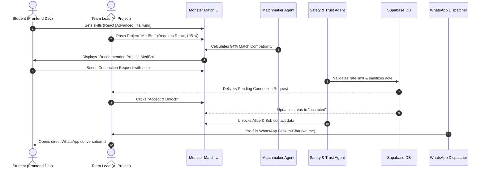

# 🤖 Monster Match: Agentic AI Ecosystem & Agent Architecture

> Documentation of the autonomous and intelligent agents that power matching, profile optimization, notification routing, and trust/safety across the Monster Match platform, along with mandatory instructions for AI coding agents.

---

## 1. Overview of the Agentic Architecture

Monster Match employs a modular, event-driven multi-agent architecture. Each agent operates with specific autonomy, communicating through Supabase Realtime event streams, database webhooks, and client-side decision services.

```
       ┌────────────────────────────────────────────────────────┐
       │              Student / Project Event Stream            │
       └───────────────────────────┬────────────────────────────┘
                                   │
         ┌─────────────────────────┼─────────────────────────┐
         ▼                         ▼                         ▼
┌───────────────────┐    ┌───────────────────┐    ┌───────────────────┐
│  Matchmaker Agent │    │ Profile Optimizer │    │ Safety & Trust    │
│  (Agent-Match)    │    │ (Agent-Profile)   │    │ (Agent-Trust)     │
└────────┬──────────┘    └────────┬──────────┘    └────────┬──────────┘
         │                        │                        │
         └────────────────────────┼────────────────────────┘
                                  ▼
                     ┌───────────────────────────┐
                     │ WhatsApp Dispatcher Agent │
                     │ (Agent-WhatsApp)          │
                     └─────────────┬─────────────┘
                                   ▼
                 Direct WhatsApp (wa.me) & Cloud API
```

---

## 2. Core Agents Specification

### 🎯 1. Matchmaker Agent (`Agent-Match`)

- **Role:** Calculates compatibility between student profiles and project requirements; identifies complementary teammates.
- **Trigger:**
  - When a student opens the Explore page or Dashboard.
  - When a team lead views "Find Matches" for a specific project.
- **Input Parameters:**
  - Student skill vector: `[{ name: string, level: 'beginner' | 'intermediate' | 'advanced' }]`
  - Student availability: hours per week
  - Student interests: array of domains (AI, Web3, Fintech, etc.)
  - Project requirement spec: `roles: [{ title, slots, skills: [] }]`
- **Algorithm & Decision Logic:**
  $$\text{Match Score} = S_{\text{skills}} + S_{\text{availability}} + S_{\text{interest}} + S_{\text{proficiency}}$$
  - **Skill Overlap ($S_{\text{skills}}$):** Up to 70 points based on proportion of required project skills satisfied.
  - **Availability Overlap ($S_{\text{availability}}$):** Up to 15 points based on student's committed weekly hours vs. project timeline.
  - **Interest Overlap ($S_{\text{interest}}$):** Up to 10 points based on category intersection.
  - **Proficiency Bonus ($S_{\text{proficiency}}$):** Up to 5 points bonus for `advanced` skill ratings.
- **Complementary Teammate Discovery:**
  - Evaluates skill gaps. For example, if a team has Backend (Node.js/Python), `Agent-Match` prioritizes candidates with Frontend (React/Vue) and Design (Figma/UI).

---

### 📝 2. Profile Optimizer Agent (`Agent-Profile`)

- **Role:** Continuously evaluates profile strength, calculates the **Completeness Meter**, and suggests improvements to maximize teammate discoverability.
- **Scoring Weights:**
  - Full Name: 15%
  - Profile Avatar / Monster Mascot: 10%
  - College & Academic Info: 10%
  - Branch & Year: 10%
  - Detailed Bio (> 20 characters): 15%
  - Contact Details (Phone/WhatsApp): 15%
  - Minimum 3 Technical Skills with Proficiency: 15%
  - Portfolio / GitHub Links: 10%
- **Actionable Outputs:**
  - Renders inline prompt badges (e.g. *"Add 2 more skills to reach 100% profile strength!"*).
  - Auto-assigns personalized monster mascots via DiceBear Bottts based on user seed.

---

### ⚡ 3. WhatsApp Dispatcher Agent (`Agent-WhatsApp`)

- **Role:** Bridges in-app connections with real-world messaging through WhatsApp.
- **Dual Pipeline Strategy:**
  1. **Phase 4 Client-Side Click-to-Chat (`wa.me`):**
     - Cleans international phone numbers (strips non-digits).
     - Formats personalized context-aware message URLs:
       `https://wa.me/<phone>?text=Hi%20{name}%2C%20I%20saw%20your%20profile%20on%20Monster%20Match...`
     - Completely free, requires zero Meta developer approval, and operates instantly on mobile and desktop.
  2. **Phase 8 Serverless WhatsApp Cloud API (`functions/send-whatsapp`):**
     - Triggered on database event `connection_requests.status = 'accepted'`.
     - Securely invokes Meta's Graph API (`POST /v18.0/{phone-number-id}/messages`) using a serverless token secret.
     - Delivers automated template alerts (`connection_request_alert`, `request_accepted`) to the receiver's phone.

---

### 🛡️ 4. Safety & Trust Agent (`Agent-Trust`)

- **Role:** Enforces privacy boundaries, college email verification, and rate limiting.
- **Core Rules:**
  - **Zero Unsolicited Contact:** Phone and WhatsApp details are never leaked in public search queries or DOM responses. Only when a mutual connection request is accepted are contacts unlocked.
  - **Academic Domain Validator:** Recognizes `.ac.in`, `.edu`, and affiliated university email domains to automatically grant the `🎓 Verified Student` badge.
  - **XSS & Content Sanitizer:** Sanitizes all user inputs (bios, project descriptions, and chat notes) to prevent cross-site scripting vulnerabilities.
  - **Rate Limiting:** Restricts outgoing connection requests to prevent spamming across the student directory.

---

## 3. Agent Lifecycle & Data Flow



---

## 4. Mandatory Instructions for AI Coding Agents (Auto-Documentation Rule)

Whenever any developer or AI coding agent performs modifications on the Monster Match codebase:

1. **Keep Tracking Files Synchronized:**
   - **`work_done.md`**: Append every newly completed feature, bug fix, or UX improvement with date and technical details.
   - **`TASKS.md`**: Update item status markers (`✅ Done`, `🔄 In Progress`, `📋 Planned`).
   - **`CHANGELOG.md`**: Record changes under the active version release section.
   - **`docs/`**: If an API signature, database schema, or environment setting is changed, immediately update `docs/API_DOCUMENTATION.md`, `docs/DATABASE_SCHEMA.md`, or `.env.example`.

2. **Commit Policy:**
   - Author: `Ishit943 <goyalishit1@gmail.com>`
   - Format: Conventional Commits (`feat:`, `fix:`, `docs:`, `style:`, `refactor:`)
   - Run `python scripts/update_docs.py` before committing to verify sync integrity.
