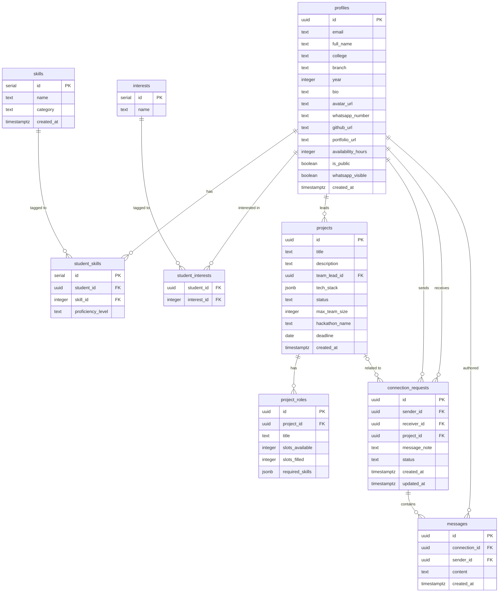

# 🗄️ Monster Match — Database Schema

> **Backend:** Supabase (PostgreSQL 15) with Row Level Security (RLS)
> **Source:** `sql/schema.sql`

---

## Table of Contents

1. [Tables Overview](#tables-overview)
2. [Table Definitions](#table-definitions)
3. [ER Diagram](#er-diagram)
4. [Row Level Security (RLS) Policies](#row-level-security-rls-policies)
5. [Triggers](#triggers)
6. [Indexes](#indexes)

---

## Tables Overview

| Table | Purpose | Row Count (Est.) |
|---|---|---|
| `profiles` | Extended user profile data linked to Supabase Auth | ~100–500 students |
| `skills` | Master catalog of technical skills | ~80–120 entries |
| `student_skills` | Junction — which skills a student has & their level | ~300–1500 rows |
| `interests` | Domain interest tags (AI, Web3, Fintech, etc.) | ~20–40 entries |
| `student_interests` | Junction — which domains a student is interested in | ~200–1000 rows |
| `projects` | Hackathon projects posted by team leads | ~50–200 projects |
| `project_roles` | Open roles within a project with slot tracking | ~100–500 roles |
| `connection_requests` | Teammate connection request lifecycle | ~500–2000 requests |
| `messages` | *(Future Phase)* Chat messages within accepted connections | TBD |

---

## Table Definitions

### `profiles`

Stores extended student profile data. Linked 1-to-1 with `auth.users` via `id` (UUID).

```sql
CREATE TABLE profiles (
  id                 UUID PRIMARY KEY REFERENCES auth.users(id) ON DELETE CASCADE,
  email              TEXT NOT NULL UNIQUE,
  full_name          TEXT,
  college            TEXT,
  branch             TEXT,                       -- e.g. "CSE", "ECE", "IT"
  year               INTEGER CHECK (year BETWEEN 1 AND 5),
  bio                TEXT,                       -- sanitized; max ~500 chars
  avatar_url         TEXT,                       -- DiceBear Bottts URL or custom
  whatsapp_number    TEXT,                       -- E.164 format, e.g. "+919876543210"
  github_url         TEXT,
  portfolio_url      TEXT,
  availability_hours INTEGER DEFAULT 0,          -- hours per week
  is_public          BOOLEAN DEFAULT TRUE,       -- profile discoverable in Explore
  whatsapp_visible   BOOLEAN DEFAULT FALSE,      -- extra gate for contact reveal
  created_at         TIMESTAMPTZ DEFAULT NOW()
);
```

| Column | Type | Nullable | Notes |
|---|---|---|---|
| `id` | `uuid` | NO | FK → `auth.users.id` |
| `email` | `text` | NO | Must match auth email |
| `full_name` | `text` | YES | Used in profile completeness |
| `college` | `text` | YES | Academic institution name |
| `branch` | `text` | YES | Engineering branch / department |
| `year` | `integer` | YES | Academic year: 1–5 |
| `bio` | `text` | YES | XSS-sanitized free-form text |
| `avatar_url` | `text` | YES | Auto-assigned DiceBear URL if not set |
| `whatsapp_number` | `text` | YES | Never exposed in public queries |
| `github_url` | `text` | YES | Portfolio link |
| `portfolio_url` | `text` | YES | Personal site / Devfolio |
| `availability_hours` | `integer` | YES | Weekly hours available for project |
| `is_public` | `boolean` | NO | Default `true` |
| `whatsapp_visible` | `boolean` | NO | Default `false` — opt-in contact sharing |
| `created_at` | `timestamptz` | NO | Auto-set on insert |

---

### `skills`

Master catalog of technical skills, pre-seeded and user-extensible.

```sql
CREATE TABLE skills (
  id          SERIAL PRIMARY KEY,
  name        TEXT NOT NULL UNIQUE,
  category    TEXT NOT NULL CHECK (category IN (
                'frontend', 'backend', 'ml', 'design', 'devops', 'other'
              )),
  created_at  TIMESTAMPTZ DEFAULT NOW()
);
```

| Column | Type | Notes |
|---|---|---|
| `id` | `serial` | Auto-incrementing PK |
| `name` | `text` | e.g. "React", "Python", "Figma" |
| `category` | `text` | Enum: `frontend`, `backend`, `ml`, `design`, `devops`, `other` |
| `created_at` | `timestamptz` | Seed insertion timestamp |

**Seed categories & examples:**

| Category | Example Skills |
|---|---|
| `frontend` | React, Vue, Angular, Tailwind CSS, HTML5, CSS3 |
| `backend` | Node.js, Python, FastAPI, Django, Go, Java |
| `ml` | TensorFlow, PyTorch, Scikit-learn, Pandas, NumPy |
| `design` | Figma, Adobe XD, Canva, UI/UX, Prototyping |
| `devops` | Docker, Kubernetes, GitHub Actions, AWS, GCP |
| `other` | Blockchain, Solidity, WebRTC, Unity, AR/VR |

---

### `student_skills`

Junction table linking students to their skills with proficiency level.

```sql
CREATE TABLE student_skills (
  id               SERIAL PRIMARY KEY,
  student_id       UUID NOT NULL REFERENCES profiles(id) ON DELETE CASCADE,
  skill_id         INTEGER NOT NULL REFERENCES skills(id) ON DELETE CASCADE,
  proficiency_level TEXT NOT NULL CHECK (proficiency_level IN (
                     'beginner', 'intermediate', 'advanced'
                   )),
  UNIQUE (student_id, skill_id)
);
```

| Column | Type | Notes |
|---|---|---|
| `student_id` | `uuid` | FK → `profiles.id` |
| `skill_id` | `integer` | FK → `skills.id` |
| `proficiency_level` | `text` | Enum: `beginner`, `intermediate`, `advanced` |

---

### `interests`

Domain interest tags for student preference matching.

```sql
CREATE TABLE interests (
  id    SERIAL PRIMARY KEY,
  name  TEXT NOT NULL UNIQUE     -- e.g. "AI/ML", "Web3", "Fintech", "EdTech"
);
```

---

### `student_interests`

Junction table linking students to their domain interests.

```sql
CREATE TABLE student_interests (
  student_id   UUID NOT NULL REFERENCES profiles(id) ON DELETE CASCADE,
  interest_id  INTEGER NOT NULL REFERENCES interests(id) ON DELETE CASCADE,
  PRIMARY KEY (student_id, interest_id)
);
```

---

### `projects`

Hackathon projects posted by team leads seeking collaborators.

```sql
CREATE TABLE projects (
  id              UUID PRIMARY KEY DEFAULT gen_random_uuid(),
  title           TEXT NOT NULL,
  description     TEXT,                          -- sanitized
  team_lead_id    UUID NOT NULL REFERENCES profiles(id) ON DELETE CASCADE,
  tech_stack      JSONB DEFAULT '[]',            -- e.g. ["React", "FastAPI", "PostgreSQL"]
  status          TEXT NOT NULL DEFAULT 'open'
                    CHECK (status IN ('open', 'closed', 'completed')),
  max_team_size   INTEGER DEFAULT 4,
  hackathon_name  TEXT,                          -- e.g. "Runtime Terror HackSprint 2026"
  deadline        DATE,
  created_at      TIMESTAMPTZ DEFAULT NOW()
);
```

| Column | Type | Notes |
|---|---|---|
| `id` | `uuid` | Auto-generated UUID PK |
| `title` | `text` | Project name |
| `description` | `text` | XSS-sanitized project pitch |
| `team_lead_id` | `uuid` | FK → `profiles.id` |
| `tech_stack` | `jsonb` | Array of tech strings |
| `status` | `text` | Enum: `open`, `closed`, `completed` |
| `max_team_size` | `integer` | Default 4 |
| `hackathon_name` | `text` | Event name |
| `deadline` | `date` | Submission deadline |
| `created_at` | `timestamptz` | Auto-set |

---

### `project_roles`

Specific roles within a project with skill requirements and slot tracking.

```sql
CREATE TABLE project_roles (
  id               UUID PRIMARY KEY DEFAULT gen_random_uuid(),
  project_id       UUID NOT NULL REFERENCES projects(id) ON DELETE CASCADE,
  title            TEXT NOT NULL,                -- e.g. "Frontend Developer"
  slots_available  INTEGER NOT NULL DEFAULT 1,
  slots_filled     INTEGER NOT NULL DEFAULT 0,
  required_skills  JSONB DEFAULT '[]',           -- e.g. ["React", "Tailwind CSS"]
  CHECK (slots_filled <= slots_available)
);
```

| Column | Type | Notes |
|---|---|---|
| `id` | `uuid` | Auto-generated UUID PK |
| `project_id` | `uuid` | FK → `projects.id` |
| `title` | `text` | Role title (e.g. "ML Engineer") |
| `slots_available` | `integer` | Total open seats |
| `slots_filled` | `integer` | Accepted applicants so far |
| `required_skills` | `jsonb` | Array of skill name strings |

---

### `connection_requests`

Manages the full lifecycle of teammate connection requests.

```sql
CREATE TABLE connection_requests (
  id           UUID PRIMARY KEY DEFAULT gen_random_uuid(),
  sender_id    UUID NOT NULL REFERENCES profiles(id) ON DELETE CASCADE,
  receiver_id  UUID NOT NULL REFERENCES profiles(id) ON DELETE CASCADE,
  project_id   UUID REFERENCES projects(id) ON DELETE SET NULL,  -- nullable
  message_note TEXT,                             -- sanitized by app before insert
  status       TEXT NOT NULL DEFAULT 'pending'
                 CHECK (status IN ('pending', 'accepted', 'rejected', 'cancelled')),
  created_at   TIMESTAMPTZ DEFAULT NOW(),
  updated_at   TIMESTAMPTZ DEFAULT NOW(),
  CHECK (sender_id <> receiver_id),
  UNIQUE (sender_id, receiver_id, project_id)   -- prevent duplicate requests
);
```

| Column | Type | Notes |
|---|---|---|
| `id` | `uuid` | Auto-generated UUID PK |
| `sender_id` | `uuid` | FK → `profiles.id` (requester) |
| `receiver_id` | `uuid` | FK → `profiles.id` (target student) |
| `project_id` | `uuid` | Optional FK → `projects.id` |
| `message_note` | `text` | Sanitized connection note |
| `status` | `text` | Enum: `pending`, `accepted`, `rejected`, `cancelled` |
| `created_at` | `timestamptz` | Request timestamp |
| `updated_at` | `timestamptz` | Last status change (auto-updated via trigger) |

---

### `messages` *(Future Phase)*

In-app messaging thread within an accepted connection.

```sql
CREATE TABLE messages (
  id             UUID PRIMARY KEY DEFAULT gen_random_uuid(),
  connection_id  UUID NOT NULL REFERENCES connection_requests(id) ON DELETE CASCADE,
  sender_id      UUID NOT NULL REFERENCES profiles(id) ON DELETE CASCADE,
  content        TEXT NOT NULL,                  -- sanitized
  created_at     TIMESTAMPTZ DEFAULT NOW()
);
```

> [!NOTE]
> This table is defined in schema for future use. Phase 4 routes all real-time communication through WhatsApp (`wa.me`). In-app messaging is planned for Phase 7+.

---

## ER Diagram



---

## Row Level Security (RLS) Policies

All tables have RLS **enabled**. Access is controlled at the PostgreSQL row level using the authenticated JWT from Supabase Auth.

### `profiles` Policies

```sql
-- Anyone authenticated can read public profiles (excludes sensitive contact fields)
CREATE POLICY "Public profiles are viewable by all authenticated users"
  ON profiles FOR SELECT
  USING (auth.role() = 'authenticated' AND is_public = TRUE);

-- Users can update only their own profile
CREATE POLICY "Users can update own profile"
  ON profiles FOR UPDATE
  USING (auth.uid() = id);

-- Users can insert their own profile row (on signup)
CREATE POLICY "Users can insert own profile"
  ON profiles FOR INSERT
  WITH CHECK (auth.uid() = id);
```

### Contact Privacy Policy (4-Step Unlock)

`whatsapp_number` is **never** returned in the standard `profiles` SELECT policy. It is only exposed through a separate secure function or view that validates:

1. An `accepted` connection exists between the requesting user and the profile owner.
2. The profile owner has `whatsapp_visible = TRUE`.

```sql
-- Returns whatsapp_number ONLY for accepted connections with opt-in
CREATE POLICY "Contact visible only for accepted connections"
  ON profiles FOR SELECT
  USING (
    auth.uid() = id  -- own profile always visible in full
    OR EXISTS (
      SELECT 1 FROM connection_requests cr
      WHERE cr.status = 'accepted'
        AND ((cr.sender_id = auth.uid() AND cr.receiver_id = profiles.id)
          OR (cr.receiver_id = auth.uid() AND cr.sender_id = profiles.id))
        AND profiles.whatsapp_visible = TRUE
    )
  );
```

### `connection_requests` Policies

```sql
-- Users can only see their own sent/received requests
CREATE POLICY "Users see own connection requests"
  ON connection_requests FOR SELECT
  USING (auth.uid() = sender_id OR auth.uid() = receiver_id);

-- Only sender can create a request
CREATE POLICY "Sender can insert connection request"
  ON connection_requests FOR INSERT
  WITH CHECK (auth.uid() = sender_id);

-- Only receiver can accept/reject; only sender can cancel
CREATE POLICY "Status update restricted to parties"
  ON connection_requests FOR UPDATE
  USING (auth.uid() = sender_id OR auth.uid() = receiver_id);
```

---

## Triggers

### `update_updated_at`

Automatically refreshes `updated_at` on every status change in `connection_requests`.

```sql
CREATE OR REPLACE FUNCTION update_updated_at_column()
RETURNS TRIGGER AS $$
BEGIN
  NEW.updated_at = NOW();
  RETURN NEW;
END;
$$ LANGUAGE plpgsql;

CREATE TRIGGER update_connection_requests_updated_at
  BEFORE UPDATE ON connection_requests
  FOR EACH ROW
  EXECUTE FUNCTION update_updated_at_column();
```

### `limit_daily_requests`

Enforces rate limiting: a single user cannot send more than **10 connection requests per 24-hour window**.

```sql
CREATE OR REPLACE FUNCTION limit_daily_requests()
RETURNS TRIGGER AS $$
DECLARE
  request_count INTEGER;
BEGIN
  SELECT COUNT(*) INTO request_count
  FROM connection_requests
  WHERE sender_id = NEW.sender_id
    AND created_at > NOW() - INTERVAL '24 hours';

  IF request_count >= 10 THEN
    RAISE EXCEPTION 'Rate limit exceeded: max 10 connection requests per 24 hours';
  END IF;

  RETURN NEW;
END;
$$ LANGUAGE plpgsql;

CREATE TRIGGER enforce_rate_limit
  BEFORE INSERT ON connection_requests
  FOR EACH ROW
  EXECUTE FUNCTION limit_daily_requests();
```

---

## Indexes

Performance indexes for the most frequent query patterns:

```sql
-- Speed up skill-based student lookups (core of Explore page)
CREATE INDEX idx_student_skills_student_id
  ON student_skills(student_id);

CREATE INDEX idx_student_skills_skill_id
  ON student_skills(skill_id);

-- Speed up connection inbox/outbox queries
CREATE INDEX idx_connection_requests_sender
  ON connection_requests(sender_id);

CREATE INDEX idx_connection_requests_receiver
  ON connection_requests(receiver_id);

-- Composite index for status-filtered queries
CREATE INDEX idx_connection_requests_parties_status
  ON connection_requests(sender_id, receiver_id, status);

-- Speed up project listing by status
CREATE INDEX idx_projects_status
  ON projects(status);

CREATE INDEX idx_projects_team_lead
  ON projects(team_lead_id);
```
